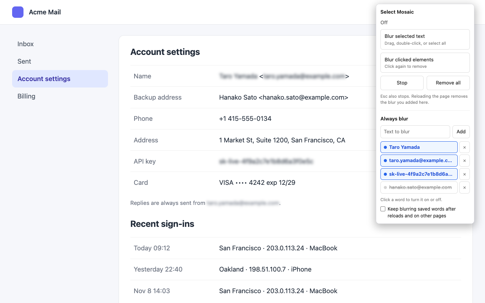

# Select Mosaic

[日本語](README.md)

A Chrome extension that blurs text you select, elements you click, and words you save. Use it to hide email addresses, names, and keys before you take a screenshot or share your screen.

## Install

The extension is being prepared for the Chrome Web Store. Until then, load it from source:

1. Clone this repository.
2. Open `chrome://extensions` (in Arc, `arc://extensions`).
3. Turn on Developer mode.
4. Click "Load unpacked" and choose the cloned folder.

## Usage

Click the toolbar icon or press Alt+Shift+M to open the popup. While a mode is on, the icon shows a `TXT` or `EL` badge.

- **Text mode**: text you select by dragging, double-clicking, or selecting all is blurred right away.
- **Element mode**: the element under the cursor is outlined; click to blur it, click again to remove the blur. Clicks do not reach the page while this mode is on.
- **Stop** or Esc ends the mode. Blur you added stays until you click **Remove all** or reload the page.

### Always blur

Saved words are blurred wherever they appear on the page, including content that loads later. Matching ignores letter case.

- Add a word from the popup, or select text and choose "Always blur" from the right-click menu.
- Click a word in the list to turn it on or off. Click × to remove it.
- The list stays after you close the browser.

By default, saved words apply only to tabs where you opened the popup or used the menu. Turn on **Keep blurring saved words after reloads and on other pages** to apply them on every page. Chrome asks for access to all sites when you turn it on; turning it off removes that access.

## Limitations

- Does not work on `chrome://` pages or the Chrome Web Store.
- Does not reach text inside iframes.
- In input fields and editors (such as an email draft), the whole field is blurred instead of the selected part, so the content you send is not changed.
- Pages that re-render (such as Gmail) may drop blur you added by hand.
- A saved word split across elements is not matched. For example, "Taro Yamada" in `<b>Taro</b> Yamada`.
- Blur only changes how the page looks. The original text stays in the page.

## Privacy

No data collection and no network requests. Saved words are kept in `chrome.storage.local` in your browser. See the [privacy policy](https://konaito.github.io/select-mosaic/privacy.html).

## License

MIT
